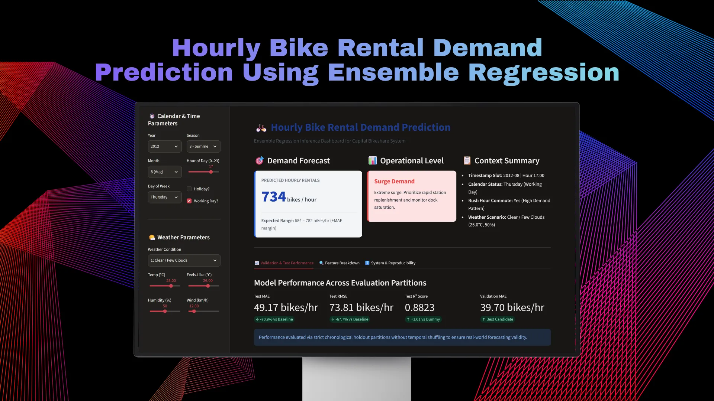
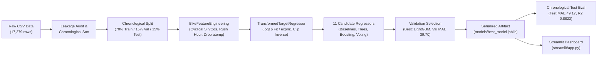
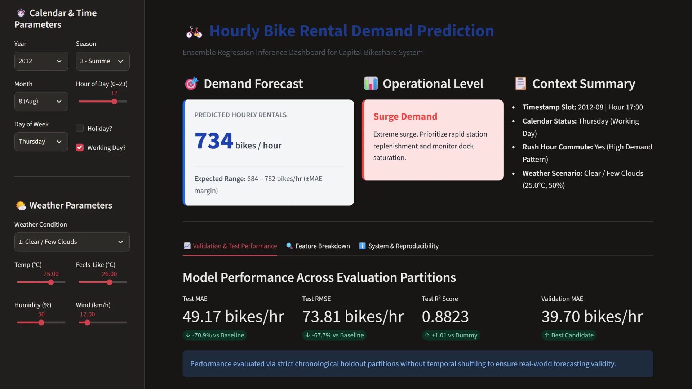
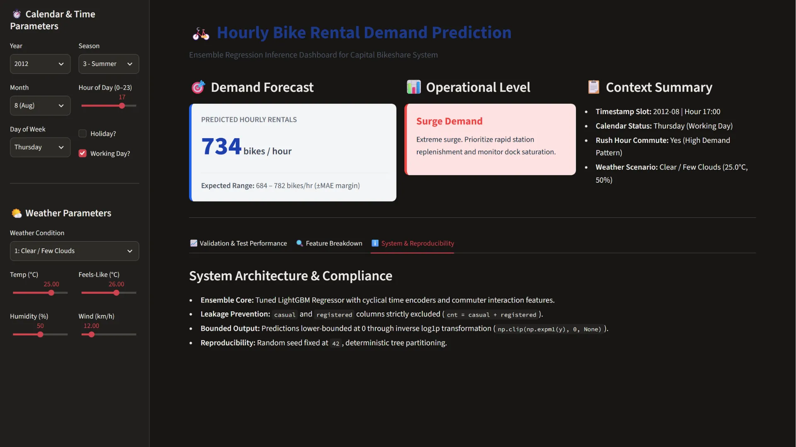
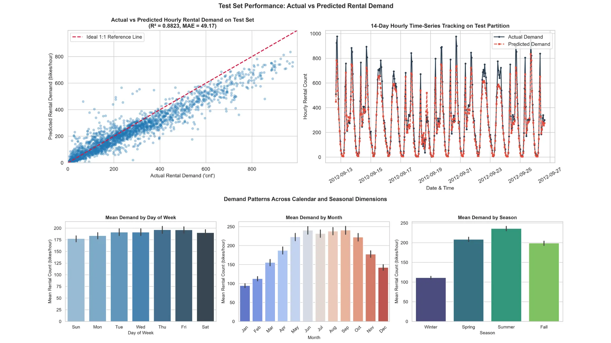
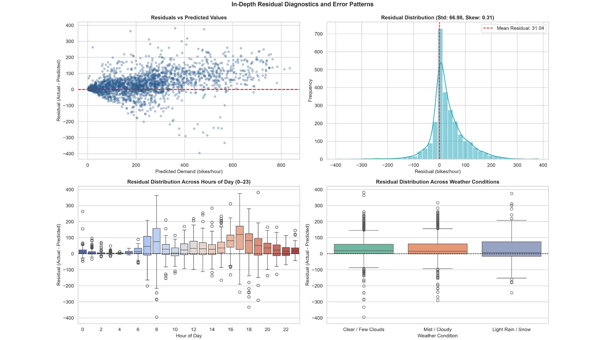
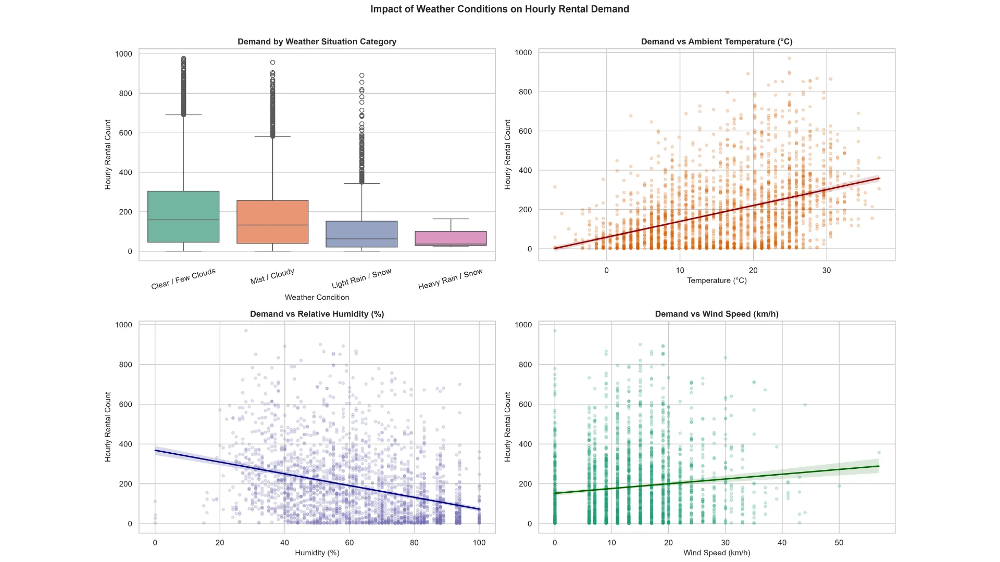
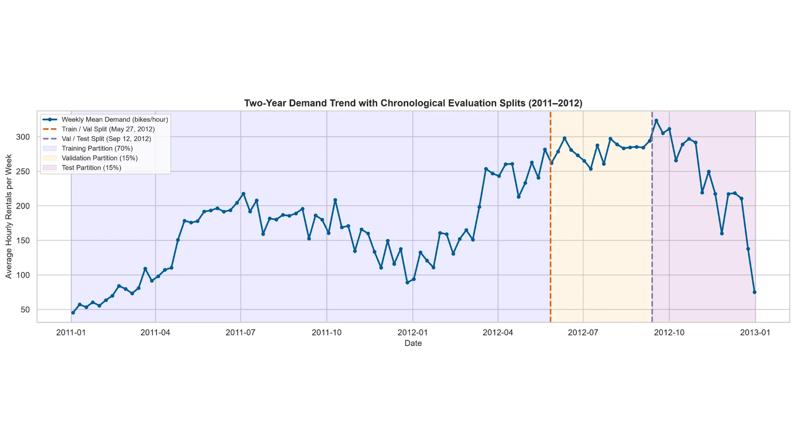
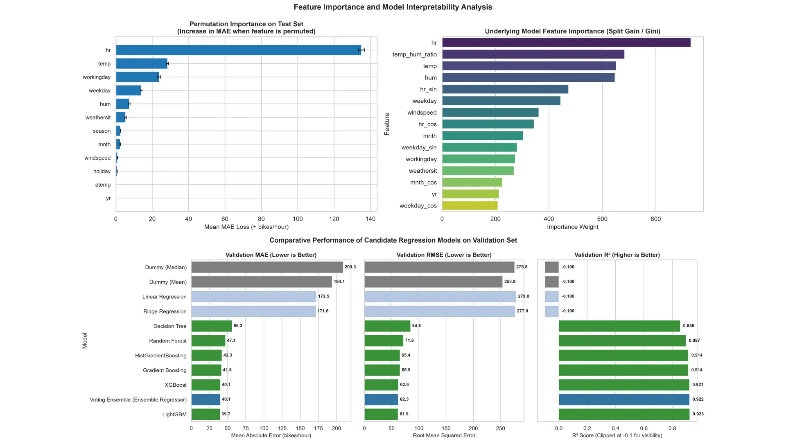

# Hourly Bike Rental Demand Prediction Using Ensemble Regression




## Project Overview

Hourly Bike Rental Demand Prediction Using Ensemble Regression is an end-to-end supervised machine learning system built to forecast hourly bicycle rental demand (`cnt`) for the Capital Bikeshare network in Washington, D.C. The project addresses operational fleet planning by combining strict target-leakage prevention, cyclical trigonometric time encoding, collinearity removal, and chronological temporal validation across 17,379 hourly records spanning 2011–2012. Eleven candidate regressors—ranging from naive baselines and regularized linear models to tree-based boosting ensembles and a weighted voting meta-ensemble—are benchmarked, with a tuned LightGBM pipeline serialized alongside an interactive Streamlit forecasting dashboard.

## Problem Statement & Objectives

Micromobility operators require accurate short-horizon hourly demand estimates to balance station dock capacity, schedule fleet redistribution trucks ahead of peak commuter surges, and allocate maintenance windows during low-demand overnight hours. Because hourly demand varies widely (1 to 977 bikes/hour) and exhibits strong non-linear interactions between time of day, working-day schedules, and weather conditions, naive averages and linear models fail under temporal demand shifts.

- Forecast hourly total bike rentals (`cnt`) using only pre-operational calendar, temporal, and meteorological attributes.
- Prevent target leakage by strictly excluding direct target components (`casual`, `registered`) and sequential row indices (`instant`).
- Eliminate extreme feature multicollinearity (`temp` vs. `atemp`, Pearson $r = 0.9877$) while capturing periodic diurnal and seasonal cycles.
- Evaluate candidate regression algorithms under a strict chronological holdout split (70% train / 15% validation / 15% test) without row shuffling.
- Package the winning preprocessing and regression pipeline into a reusable `.joblib` artifact served through an interactive Streamlit inference application.

## Data & Input Sources

The project uses the UCI Machine Learning Repository Bike Sharing dataset (`dataset/original/Bike_Sharing.csv` and `metadata.json`), originally compiled by Hadi Fanaee-T and João Gama (2013) from the Capital Bikeshare system in Washington, D.C. The dataset covers 731 calendar days from January 1, 2011 to December 31, 2012, containing 17,379 verified hourly records with zero missing values and zero duplicate rows (165 unrecorded hours across 76 days are preserved without synthetic imputation).

| Attribute | Description |
|---|---|
| Dataset / Input Source | UCI Bike Sharing Dataset (Capital Bikeshare, Washington, D.C.) |
| Source | `dataset/original/Bike_Sharing.csv`, `dataset/original/metadata.json` |
| Format | CSV (`17,379` rows × `17` columns) |
| Samples / Records | 17,379 hourly observations (Train: 12,165 / Val: 2,606 / Test: 2,608) |
| Features / Input Shape | 11 core predictors (`season`, `yr`, `mnth`, `hr`, `holiday`, `weekday`, `workingday`, `weathersit`, `temp`, `hum`, `windspeed`) + engineered cyclical/domain features |
| Target / Label | `cnt` (continuous integer count, range 1–977 bikes/hour; mean 189.46, median 142) |

## Data Preprocessing & Feature Engineering

All preprocessing and domain feature transformations are encapsulated inside a custom Scikit-learn `BikeFeatureEngineering` transformer paired with `TransformedTargetRegressor` so that transformations remain leak-free and deterministic between training and inference.

| Transformation | Input Features | Output / Effect |
|---|---|---|
| Leakage Column Exclusion | `instant`, `casual`, `registered`, `cnt`, `dteday`, `timestamp` | Removed from feature matrix `X` prior to modeling |
| Multicollinearity Pruning | `atemp`, `temp` | Drops `atemp` ($r = 0.9877$ with `temp`) to stabilize feature space |
| Cyclical Time Encoding | `hr`, `mnth`, `weekday` | `hr_sin`, `hr_cos`, `mnth_sin`, `mnth_cos`, `weekday_sin`, `weekday_cos` |
| Commuter Surge Indicator | `hr`, `workingday` | Binary `is_rush_hour` flag for `hr` in `{8, 9, 17, 18}` on working days |
| Thermal Comfort Ratio | `temp`, `hum` | `temp_hum_ratio = temp / (hum + 1e-4)` interaction feature |
| Linear Model Encoding | Categorical & numeric predictors | `StandardScaler` + `OneHotEncoder(drop="first")` for OLS and Ridge |
| Target Log-Transform | `cnt` | `np.log1p` during fit; `np.clip(np.expm1(y), 0, None)` on prediction |

1. Verify `cnt == casual + registered` integrity across all rows and sort chronologically by combined `dteday` + `hr` timestamp.
2. Partition records chronologically into Train (first 70%), Validation (middle 15%), and Test (final 15%) sets.
3. Strip target leakage and index columns via `prepare_features_and_target`.
4. Fit `BikeFeatureEngineering(drop_atemp=True)` inside a Scikit-learn `Pipeline` wrapped by `TransformedTargetRegressor`.

## Tech Stack

| Category | Technology | Purpose |
|---|---|---|
| Programming Language | Python | Core scripting, modeling pipeline, and application runtime |
| ML & Preprocessing | Scikit-learn | `Pipeline`, `ColumnTransformer`, `TransformedTargetRegressor`, linear/tree baselines, permutation importance |
| Gradient Boosting | LightGBM | Primary tuned `LGBMRegressor` achieving lowest validation and test error |
| Gradient Boosting | XGBoost | Candidate boosted tree regressor and Voting Ensemble component |
| Data Processing | Pandas, NumPy | Chronological data loading, timestamp parsing, array and log-space arithmetic |
| Visualization | Matplotlib, Seaborn | Publication-grade EDA plots, residual diagnostics, model comparison charts |
| Model Serialization | Joblib | Exporting and reloading the end-to-end `best_model.joblib` pipeline |
| Interactive Dashboard | Streamlit | Web inference UI (`streamlit/app.py`) with scenario controls and performance tabs |
| Notebook Environment | Jupyter Notebook, nbformat | Exploratory and end-to-end experiment notebook (`notebooks/bike_sharing_regression.ipynb`) |

## Machine Learning Approach

The project formulates hourly bike rental forecasting as a supervised tabular regression problem over chronologically ordered observational records. Because the Capital Bikeshare network experienced substantial ridership growth from 2011 (~130 bikes/hour average) to 2012 (~240 bikes/hour average) and exhibits strongly non-linear diurnal-weather interactions, non-parametric gradient boosted decision trees paired with a `log1p` target transformation outperform linear baselines.

| Dimension | Specification |
|---|---|
| Learning Paradigm | Supervised Learning |
| Problem Domain | Urban Micromobility Demand Forecasting |
| ML Task | Tabular Regression |
| Input Space | Calendar, temporal, and normalized meteorological predictors |
| Target Output | Hourly bike rental count (`cnt`, non-negative bikes/hour) |
| Validation Protocol | Strict chronological 70/15/15 split without shuffling |

## Model Overview

Eleven regression models were trained on the chronological training partition (Jan 2011 – May 2012) and compared on the chronological validation partition (May 2012 – Sep 2012). A tuned `LGBMRegressor` wrapped in `TransformedTargetRegressor` achieved the lowest validation MAE (`39.70` bikes/hour) and highest $R^2$ (`0.9232`), edging out a weighted `VotingRegressor` (`0.40` LightGBM, `0.35` HistGradientBoosting, `0.25` XGBoost) and serving as the deployed model artifact.

| Attribute | Details |
|---|---|
| Selected Primary Model | `LGBMRegressor` inside `TransformedTargetRegressor` pipeline |
| Model Family | Gradient Boosted Decision Trees (Ensemble Regression) |
| Framework | LightGBM + Scikit-learn |
| Comparison Candidates | Dummy (Mean, Median), Linear Regression (OLS), Ridge, Decision Tree, Random Forest, Gradient Boosting, HistGradientBoosting, XGBoost, LightGBM, Voting Ensemble |
| Input Features | 18 engineered features after `BikeFeatureEngineering` (dropping `atemp`) |
| Output Space | Non-negative continuous rental forecast (bikes/hour) |
| Pretrained Status | Trained from scratch on the 12,165-row training partition (`random_state=42`) |

## ML Workflow

The end-to-end experimental workflow is implemented across modular Python scripts in `src/`, a comprehensive report in [final_report.md](final_report.md), and an interactive dashboard in [streamlit/app.py](streamlit/app.py):

1. **Data Quality & Leakage Audit** ([src/audit_data.py](src/audit_data.py)): Inspects `metadata.json` and `Bike_Sharing.csv`, confirms zero missing values and zero duplicates, validates `cnt == casual + registered`, checks timestamp monotonicity, and measures `temp`/`atemp` Pearson correlation (`0.98767`).
2. **Exploratory Data Analysis** ([src/eda_visualizations.py](src/eda_visualizations.py)): Generates six diagnostic plots covering target skewness, diurnal working-day vs. weekend curves, calendar/seasonal trends, weather impacts, two-year weekly demand drift, and feature correlation heatmaps.
3. **Chronological Partitioning & Feature Pipeline** ([src/data_preparation.py](src/data_preparation.py)): Sorts records chronologically, performs the 70/15/15 train/val/test split, removes leakage columns, and builds the `BikeFeatureEngineering` transformer.
4. **Candidate Training & Validation Selection** ([src/train.py](src/train.py)): Trains all 11 models with `log1p` target transformation (for non-dummy models), logs metrics to [models/validation_results.json](models/validation_results.json) and [models/validation_results.csv](models/validation_results.csv), plots candidate comparisons, and serializes the best pipeline to `models/best_model.joblib`.
5. **Single-Pass Test Evaluation & Interpretability** ([src/evaluate.py](src/evaluate.py)): Evaluates `models/best_model.joblib` on the isolated test partition (Sep–Dec 2012), computes sliced MAE/RMSE across working days, weather, and rush hours, computes 10-repeat permutation importance, and writes [models/test_evaluation_results.json](models/test_evaluation_results.json).
6. **Interactive Inference Serving** ([streamlit/app.py](streamlit/app.py)): Loads `models/best_model.joblib` via `@st.cache_resource`, transforms user-selected calendar and weather sliders into UCI-normalized inputs, and outputs predicted demand, $\pm\text{MAE}$ range, operational load tier, and model metrics.

## ML Pipeline Architecture

The pipeline processes chronological hourly records through a leak-free Scikit-learn `Pipeline` and `TransformedTargetRegressor`, ensuring identical feature transformations during offline evaluation and live Streamlit inference.



## Model Training & Configuration

All parametric and tree-based models were trained from scratch on the 12,165-row chronological training partition (`2011-01-01 00:00:00` to `2012-05-27 01:00:00`) with `random_state=42` and target `log1p` transformation. Hyperparameters for the selected `LGBMRegressor` and ensemble peers are explicitly defined in [src/train.py](src/train.py).

| Parameter / Setting | Configured Value | Role in Training |
|---|---|---|
| `n_estimators` | `200` | Number of sequential boosting trees in LightGBM |
| `learning_rate` | `0.07` | Shrinkage step size balancing convergence and generalization |
| `max_depth` | `8` | Maximum tree depth controlling interaction complexity |
| `num_leaves` | `35` | Leaf-wise tree capacity limit per boosting round |
| `min_child_samples` | `20` | Minimum observations per leaf to curb overfitting |
| `subsample` / `colsample_bytree` | `0.8` / `0.8` | Row and column subsampling ratios for variance reduction |
| `reg_alpha` / `reg_lambda` | `0.1` / `1.0` | L1 and L2 leaf weight regularization penalties |
| `TransformedTargetRegressor` | `np.log1p` / `inverse_nonnegative` | Stabilizes right-skewed `cnt` target and enforces `>= 0` predictions |
| `random_state` | `42` | Deterministic seed across all tree and ensemble models |

```powershell
python src/train.py
```

## Model Comparison & Selection

Eleven candidate models were evaluated on the chronological validation partition (`2,606` hourly records from `2012-05-27 02:00:00` to `2012-09-12 15:00:00`) using identical preprocessing and target transformations. Tree boosting methods consistently outperformed linear models, which suffered negative validation $R^2$ due to non-linear diurnal patterns and year-over-year ridership growth.

| Model | Train MAE | Train RMSE | Train $R^2$ | Val MAE | Val RMSE | Val $R^2$ | Overfitting Gap (MAE) |
|---|---:|---:|---:|---:|---:|---:|---:|
| Dummy (Mean) | 119.74 | 152.57 | 0.0000 | 194.08 | 253.93 | -0.2939 | +74.34 |
| Dummy (Median) | 115.63 | 157.97 | -0.0720 | 209.35 | 275.79 | -0.5263 | +93.71 |
| Linear Regression | 74.41 | 122.49 | 0.3555 | 172.52 | 278.98 | -0.5618 | +98.11 |
| Ridge Regression | 74.34 | 122.19 | 0.3586 | 171.57 | 276.99 | -0.5396 | +97.24 |
| Decision Tree | 32.08 | 51.64 | 0.8854 | 56.33 | 84.80 | 0.8557 | +24.24 |
| Random Forest | 13.33 | 22.65 | 0.9780 | 47.07 | 71.76 | 0.8967 | +33.74 |
| HistGradientBoosting | 20.13 | 33.22 | 0.9526 | 42.30 | 65.44 | 0.9141 | +22.17 |
| Gradient Boosting | 18.39 | 30.09 | 0.9611 | 41.59 | 65.48 | 0.9139 | +23.20 |
| XGBoost | 17.97 | 29.63 | 0.9623 | 40.13 | 62.57 | 0.9214 | +22.16 |
| Voting Ensemble | 18.89 | 31.18 | 0.9582 | 40.12 | 62.32 | 0.9221 | +21.23 |
| **LightGBM (Selected)** | **19.45** | **32.03** | **0.9559** | **39.70** | **61.85** | **0.9232** | **+20.25** |

## Model Artifacts & Checkpoints

All trained pipeline weights and evaluation outputs generated by `src/train.py` and `src/evaluate.py` are persisted locally inside `models/`.

| Artifact | Format | Purpose | Location |
|---|---|---|---|
| `best_model.joblib` | Joblib (`TransformedTargetRegressor` + `Pipeline`) | Serialized LightGBM pipeline including `BikeFeatureEngineering` | [models/best_model.joblib](models/best_model.joblib) |
| `validation_results.json` | JSON | Structured Train/Validation metrics for all 11 candidates | [models/validation_results.json](models/validation_results.json) |
| `validation_results.csv` | CSV | Tabular Train/Validation benchmark table | [models/validation_results.csv](models/validation_results.csv) |
| `test_evaluation_results.json` | JSON | Final out-of-sample test metrics and sliced error breakdowns | [models/test_evaluation_results.json](models/test_evaluation_results.json) |

## Model Evaluation & Results

Final out-of-sample evaluation was performed once on the isolated chronological test partition (`2,608` hourly observations from `2012-09-12 16:00:00` to `2012-12-31 23:00:00`). Compared against the training-mean Dummy baseline evaluated on the same test set, LightGBM reduced MAE by **70.9%** and RMSE by **67.7%**.

| Metric | LightGBM (Test Set) | Dummy Mean Baseline (Test Set) | Relative Improvement |
|---|---:|---:|---|
| MAE (bikes/hour) | **49.17** | 169.03 | -70.9% error reduction |
| RMSE (bikes/hour) | **73.81** | 228.42 | -67.7% error reduction |
| $R^2$ Score | **0.8823** | -0.1274 | +1.0097 ($88.23\%$ variance explained) |
| Mean Bias Error (MBE) | -31.04 | -75.85 | Moderate underprediction under late-2012 demand growth |

- **Directional Error & Temporal Drift:** `73.47%` of test hours exhibited mild underprediction (`actual > predicted`) and `26.53%` exhibited overprediction, reflecting continued user growth in Q4 2012 compared to the 2011–early 2012 training period.
- **Calendar & Rush-Hour Slices:** Test MAE remained balanced between working days (`49.75` bikes/hr, $n=1,745$) and weekends/holidays (`48.01` bikes/hr, $n=863$). Off-peak hours achieved `41.08` MAE ($n=2,316$), while commuter rush hours (`is_rush_hour = 1`, $n=292$) showed `113.35` MAE due to high peak magnitudes (800–977 bikes/hr).
- **Weather Condition Slices:** Clear weather (`weathersit = 1`, $n=1,560$) achieved `47.14` MAE, misty/cloudy (`weathersit = 2`, $n=862$) achieved `49.19` MAE, and light rain/snow (`weathersit = 3`, $n=186$) rose to `66.18` MAE.
- **Feature Drivers:** 10-repeat test-set permutation importance identified `hr` (hour of day) as the dominant predictor (>130 MAE increase when permuted), followed by `temp`, `workingday`, `weekday`, `hum`, and `weathersit`.

## Results Visualization & Preview

### 1. Streamlit Forecasting Dashboard — Validation & Test Performance

The primary Streamlit inference interface displaying a predicted surge demand of 734 bikes/hour (expected range 684–782 bikes/hour) for a clear August Thursday at 17:00, alongside the Validation & Test Performance tab summarizing Test MAE (49.17), Test RMSE (73.81), Test $R^2$ (0.8823), and Validation MAE (39.70).

### 2. Streamlit Forecasting Dashboard — Input Feature Breakdown

The Feature Breakdown tab inspecting the real-time normalized feature vector passed into `best_model.joblib`, displaying UCI-scaled `temp`, `atemp`, `hum`, and `windspeed` alongside physical units (`25°C`, `50%` humidity, `12 km/h` wind).

### 3. Streamlit Forecasting Dashboard — System Architecture & Compliance

The System & Reproducibility tab documenting core production safeguards: the tuned LightGBM pipeline, strict removal of `casual` and `registered` leakage columns, non-negative `expm1` output clipping, and deterministic `random_state = 42`.

### 4. Test Set Predictions & Calendar Demand Patterns

Top: Test-set scatter plot ($R^2 = 0.8823$, MAE = 49.17) showing tight clustering along the 1:1 line and a 14-day chronological trace capturing daily bimodal commuter peaks and overnight troughs. Bottom: Exploratory mean demand distributions across day of week, month (May–October plateau), and season (Summer peak).

### 5. In-Depth Residual Diagnostics & Error Patterns

Four-panel residual diagnostic grid illustrating residuals vs. predicted demand, a near-centered residual distribution (Std 66.98, Skew 0.31, Mean Residual 31.04), hourly error spread peaking during 08:00 and 17:00–18:00 rush hours, and stable residual medians across weather categories.

### 6. Weather Impact on Hourly Rental Demand

Four-panel exploratory analysis contrasting demand across weather categories (`Clear` highest vs. `Light Rain / Snow` sharp drop) and regression trend plots confirming positive association with ambient temperature and negative association with relative humidity.

### 7. Diurnal Demand Dynamics & Target Distribution

Top: Diurnal curves contrasting bimodal weekday commuter peaks (08:00 at ~359 bikes/hr and 17:00–18:00 at ~461 bikes/hr) against a unimodal weekend leisure peak (12:00–16:00 at ~370 bikes/hr). Bottom: Right-skewed raw `cnt` distribution (skewness 1.28) normalized via `log1p(cnt)` (skewness -0.82).

### 8. Two-Year Weekly Demand Trend & Chronological Splits

Weekly mean rental demand from January 2011 through December 2012 illustrating structural ridership growth from 2011 to 2012 and demarcating the chronological 70% Train, 15% Validation (May 27, 2012), and 15% Test (September 12, 2012) boundaries.

### 9. Feature Importance & Candidate Model Comparison

Top: Test-set permutation importance confirming `hr` and `temp` as top predictive drivers alongside LightGBM split-gain weights (`temp_hum_ratio`, `hr_sin`). Bottom: Validation MAE, RMSE, and $R^2$ comparison across all 11 models showing LightGBM achieving the best validation score (`39.70` MAE, `0.9232` $R^2$).

### 10. Numeric & Encoded Feature Correlation Matrix

Lower-triangle Pearson correlation heatmap highlighting extreme collinearity between `temp` and `atemp` ($r = 0.99$)—justifying `atemp` elimination—as well as linear associations of `cnt` with `temp` ($0.40$), `hr` ($0.39$), `hum` ($-0.32$), and `yr` ($0.25$).

## Prerequisites

- **Operating System:** Windows, Linux, or macOS (tested on Windows 64-bit).
- **Python Runtime:** Python 3.10+ (environment documented in `final_report.md` used Python 3.15.1).
- **Core Python Packages:** Listed in [requirements.txt](requirements.txt) (`scikit-learn`, `pandas`, `numpy`, `lightgbm`, `xgboost`, `streamlit`, `joblib`, `matplotlib`, `seaborn`, `nbformat`).
- **Compute Hardware:** Standard multi-core CPU; no GPU or CUDA acceleration is required for training or inference.

## Installation & Setup

1. Clone the repository and enter the project directory:

```powershell
git clone https://github.com/weztcy/Hourly-Bike-Rental-Demand-Prediction-Using-Ensemble-Regression.git
cd "Hourly-Bike-Rental-Demand-Prediction-Using-Ensemble-Regression"
```

2. Create and activate a virtual environment:

```powershell
python -m venv .venv
.\.venv\Scripts\Activate.ps1
```

3. Install required dependencies from [requirements.txt](requirements.txt):

```powershell
pip install -r requirements.txt
```

4. Ensure the dataset CSV is accessible at the repository root when running `src/` scripts (the source archive resides at `dataset/original/Bike_Sharing.csv`):

```powershell
Copy-Item dataset\original\Bike_Sharing.csv .\Bike_Sharing.csv
```

## Usage & Execution

To run interactive demand forecasting using the pre-serialized `models/best_model.joblib` pipeline, launch the Streamlit application from the repository root:

1. Start the Streamlit server:

```powershell
python -m streamlit run streamlit/app.py
```

2. Open the local dashboard URL displayed in the terminal (default `http://localhost:8501`).
3. Adjust calendar (`Year`, `Season`, `Month`, `Hour`, `Day of Week`, `Holiday`, `Working Day`) and weather sliders (`Weather Condition`, `Temp`, `Feels-Like`, `Humidity`, `Wind`) in the sidebar to inspect live hourly demand predictions, operational load classification, and validation/test metrics.

## Reproducibility & Execution

All experiments can be reproduced deterministically using the fixed `random_state = 42` seed and strict chronological splitting implemented in `src/`. Exact metric parity relies on matching the pinned package versions in [requirements.txt](requirements.txt) and keeping `Bike_Sharing.csv` in the working directory.

1. Run the dataset quality and target-leakage verification script:

```powershell
python src/audit_data.py
```

2. Generate exploratory data analysis figures:

```powershell
python src/eda_visualizations.py
```

3. Train all 11 candidate models on the 70% chronological training split, select the best model on the 15% validation split, and export `models/best_model.joblib`:

```powershell
python src/train.py
```

4. Run the single-pass evaluation and 10-repeat permutation importance analysis on the 15% chronological test split:

```powershell
python src/evaluate.py
```

5. Alternatively, open and execute [notebooks/bike_sharing_regression.ipynb](notebooks/bike_sharing_regression.ipynb) for the unified notebook workflow.

## Contributing

Contributions are welcome for bug fixes, additional temporal validation experiments, or dashboard enhancements. Please follow this standard workflow:

1. Fork the repository.
2. Create a branch for the change.
3. Make the changes.
4. Run relevant checks or tests when available.
5. Commit and push the branch.
6. Open a pull request with a clear explanation.

## License

This project is licensed under the MIT License.
See the [LICENSE](LICENSE) file for details.

## Author & Contact

**Yohanes Dimas Pratama**

- GitHub: [github.com/weztcy](https://github.com/weztcy)
- Portfolio: [yohanesdimas.com](https://yohanesdimas.com)
- LinkedIn: [linkedin.com/in/yohanes-dimas](https://www.linkedin.com/in/yohanes-dimas)
