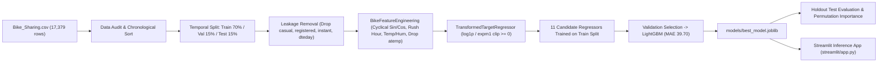
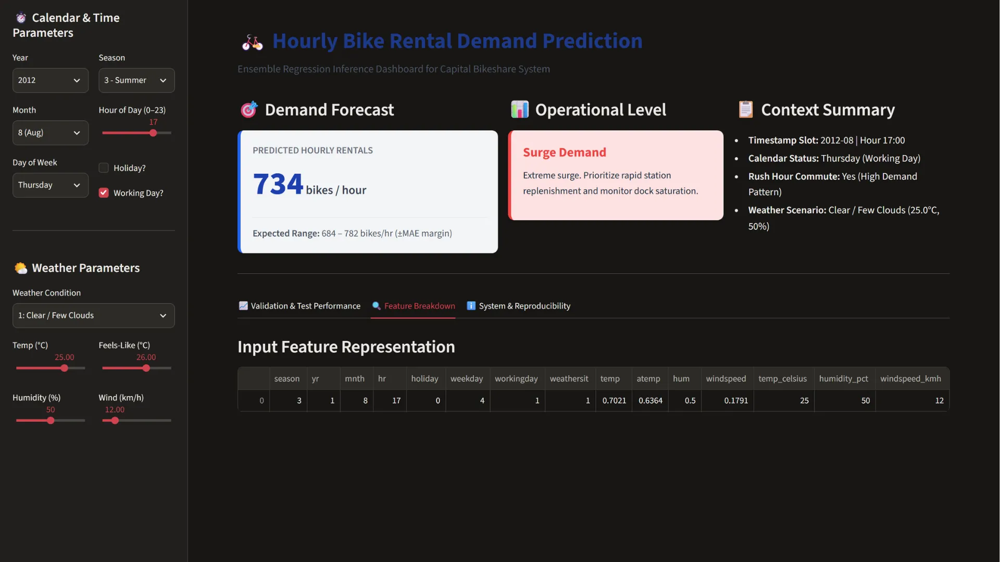
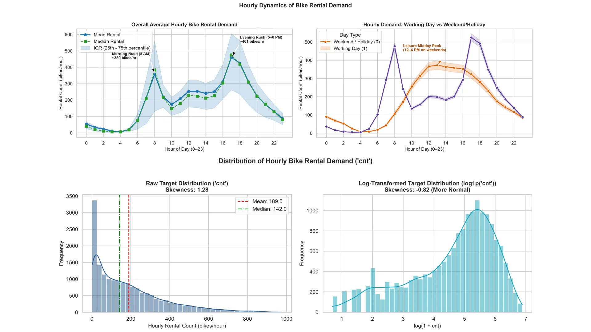
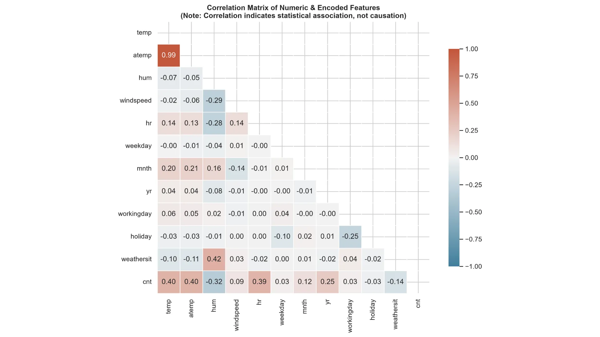

# Hourly Bike Rental Demand Prediction Using Ensemble Regression


## Project Overview

Hourly Bike Rental Demand Prediction Using Ensemble Regression is an end-to-end supervised machine learning project that forecasts hourly bicycle rental counts (`cnt`) for the Capital Bikeshare system in Washington, D.C. By combining temporal calendar attributes, meteorological conditions, trigonometric cyclical encoding, and domain-specific commuter interaction features, the pipeline models nonlinear demand fluctuations across working days, weekends, seasons, and weather states. The finalized LightGBM pipeline is serialized with `joblib` and served locally through an interactive Streamlit inference dashboard (`streamlit/app.py`) to support operational fleet rebalancing and maintenance planning.

## Problem Statement & Objectives

Urban bike-sharing systems experience sharp hourly demand shifts driven by weekday commuter peaks, weekend recreational riding, seasonal temperature changes, and adverse weather. Without reliable hourly demand forecasts, fleet operators face dock saturation at high-volume commuter hubs or bike shortages during peak hours, while struggling to schedule station maintenance during true low-demand windows.

- Formulate hourly rental count (`cnt`, ranging from 1 to 977 bikes/hour) as a quantitative supervised regression task rather than coarse classification buckets.
- Prevent target and temporal leakage by strictly excluding direct target components (`casual`, `registered`), sequential row indices (`instant`), and future rolling aggregations.
- Preserve real-world forecasting validity through a pure chronological 70% / 15% / 15% train-validation-test split without row shuffling.
- Benchmark 11 candidate models spanning naive baselines, linear models, decision trees, bagging, gradient boosting ensembles, and a weighted Voting Regressor on the chronological validation split.
- Deliver a reproducible, leakage-free serialized inference pipeline (`models/best_model.joblib`) paired with residual diagnostics, permutation importance analysis, and an interactive Streamlit dashboard.

## Data & Input Sources

The project uses the hourly Capital Bikeshare dataset (2011–2012) originating from the UCI Machine Learning Repository (Hadi Fanaee-T & João Gama, 2013), stored locally in [dataset/original/Bike_Sharing.csv](dataset/original/Bike_Sharing.csv) alongside dataset metadata in [dataset/original/metadata.json](dataset/original/metadata.json). Auditing via [src/audit_data.py](src/audit_data.py) confirms 17,379 valid hourly observations across 731 calendar days (with 165 unrecorded operational hours left unimputed to avoid synthetic target fabrication), zero missing values, zero duplicate rows, and 100% identity consistency for `cnt = casual + registered`.

| Attribute | Description |
|---|---|
| Dataset / Input Source | UCI Bike Sharing Dataset — Capital Bikeshare Hourly Records (Washington, D.C.) |
| Source | [dataset/original/Bike_Sharing.csv](dataset/original/Bike_Sharing.csv) & [dataset/original/metadata.json](dataset/original/metadata.json) |
| Format | Tabular CSV (17 columns: 13 predictors/date, 1 index, 3 target-related fields) |
| Samples / Records | 17,379 hourly observations (2011-01-01 00:00 to 2012-12-31 23:00) |
| Features / Input Shape | 11 retained raw features (`season`, `yr`, `mnth`, `hr`, `holiday`, `weekday`, `workingday`, `weathersit`, `temp`, `hum`, `windspeed`) + 8 engineered features |
| Target / Label | `cnt` (continuous/discrete hourly total rentals, mean 189.46, median 142, range 1–977) |

## Data Preprocessing & Feature Engineering

Implemented in [src/data_preparation.py](src/data_preparation.py), the preprocessing stage enforces strict leakage controls, resolves severe thermal multicollinearity (`temp` vs. `atemp` Pearson correlation `r = 0.98767`), encodes periodic temporal attributes continuously, and applies a logarithmic target wrapper (`TransformedTargetRegressor` with `np.log1p` and `inverse_nonnegative` lower-bounded at 0).

| Transformation | Input Features | Output / Effect |
|---|---|---|
| Leakage & Index Exclusion | `instant`, `dteday`, `timestamp`, `casual`, `registered`, `cnt` | Removed from feature matrix `X` prior to modeling |
| Multicollinearity Elimination | `atemp` | Dropped due to `r = 0.98767` correlation with `temp` |
| Cyclical Trigonometric Encoding | `hr`, `mnth`, `weekday` | `hr_sin`, `hr_cos`, `mnth_sin`, `mnth_cos`, `weekday_sin`, `weekday_cos` |
| Commuter Peak Indicator | `hr`, `workingday` | Binary `is_rush_hour` (`1` when `hr` in `{8, 9, 17, 18}` and `workingday == 1`) |
| Thermal Comfort Interaction | `temp`, `hum` | `temp_hum_ratio = temp / (hum + 1e-4)` |
| Linear Branch Encoding | Categorical & numeric subsets | `StandardScaler` + `OneHotEncoder(drop="first")` inside `ColumnTransformer` |
| Target Transformation | `cnt` | `log1p(cnt)` training target; `clip(expm1(y_pred), 0, None)` inverse prediction |

1. Load [dataset/original/Bike_Sharing.csv](dataset/original/Bike_Sharing.csv), verify `casual + registered == cnt`, construct chronological `timestamp`, and sort ascending.
2. Partition records chronologically without shuffling into Training (70.00%, 12,165 rows), Validation (15.00%, 2,606 rows), and Test (15.01%, 2,608 rows).
3. Exclude `instant`, `dteday`, `timestamp`, `casual`, `registered`, and `cnt` from predictor columns via `prepare_features_and_target`.
4. Fit `BikeFeatureEngineering(drop_atemp=True)` inside the `Pipeline` and wrap tree/linear estimators with `TransformedTargetRegressor`.

## Tech Stack

| Category | Technology | Purpose |
|---|---|---|
| Primary Language | Python | Core scripting, modeling, evaluation, and application runtime |
| Data Processing | Pandas, NumPy | Chronological data loading, feature engineering, and array transformations |
| ML & Ensemble Core | Scikit-learn, LightGBM, XGBoost | Pipeline orchestration, target transformation, baseline/tree/boosting/voting regressors |
| Model Serialization | Joblib | Persisting and reloading the full `models/best_model.joblib` pipeline |
| Visualization | Matplotlib, Seaborn | EDA plots, model comparisons, residual diagnostics, and importance charts |
| Interactive Interface | Streamlit | Local web dashboard ([streamlit/app.py](streamlit/app.py)) for real-time demand forecasting |
| Notebook Tooling | Jupyter / nbformat | Reproducible exploratory & modeling notebook ([notebooks/bike_sharing_regression.ipynb](notebooks/bike_sharing_regression.ipynb)) |

## Machine Learning Approach

The system frames hourly demand forecasting as a tabular supervised regression problem over chronologically ordered observations. Because demand exhibits a skewed distribution (skewness `1.28`), strong diurnal bimodality on working days, and nonlinear weather-time interactions, tree-based gradient boosting ensembles trained on `log1p`-transformed targets outperform linear models under temporal distribution shift.

| Attribute | Specification |
|---|---|
| Learning Paradigm | Supervised Learning |
| Problem Domain | Urban Micromobility & Bike-Sharing Demand Forecasting |
| ML Task | Regression (Hourly Count Prediction) |
| Input Space | Calendar, temporal, and normalized meteorological predictors (18 engineered features) |
| Target / Output | `cnt` — non-negative hourly bike rental count (`bikes/hour`) |
| Validation Strategy | Pure chronological split (70% Train / 15% Validation / 15% Test) |

## Model Overview

Eleven regression configurations are evaluated in [src/train.py](src/train.py), ranging from naive `DummyRegressor` heuristics to linear models (`LinearRegression`, `Ridge`), single tree (`DecisionTreeRegressor`), bagging (`RandomForestRegressor`), sequential boosting (`GradientBoostingRegressor`, `HistGradientBoostingRegressor`, `XGBRegressor`, `LGBMRegressor`), and a weighted `VotingRegressor`. Based on validation MAE and RMSE, `LGBMRegressor` is selected as the primary production model inside a `TransformedTargetRegressor(Pipeline([BikeFeatureEngineering, LGBMRegressor]))` wrapper.

| Attribute | Details |
|---|---|
| Primary Selected Model | `LGBMRegressor` (wrapped in `TransformedTargetRegressor` + `Pipeline`) |
| Ensemble Architecture | Histogram-based gradient boosted decision trees (200 trees, max depth 8, 35 leaves) |
| Secondary Benchmark Ensemble | `VotingRegressor` (`LGBMRegressor` 0.40, `HistGradientBoostingRegressor` 0.35, `XGBRegressor` 0.25) |
| Frameworks | LightGBM, Scikit-learn, XGBoost |
| Training Status | Trained from scratch on the chronological Training partition (`random_state=42`) |
| Serialized Artifact | `models/best_model.joblib` |

## ML Workflow

1. **Data Audit & Leakage Verification**: Inspect [dataset/original/Bike_Sharing.csv](dataset/original/Bike_Sharing.csv) and [dataset/original/metadata.json](dataset/original/metadata.json) using [src/audit_data.py](src/audit_data.py) to verify zero missing values, monotonic timestamps, `temp`/`atemp` collinearity, and `cnt == casual + registered`.
2. **Exploratory Data Analysis**: Generate distribution, diurnal, calendar, weather, long-term trend, and correlation plots via [src/eda_visualizations.py](src/eda_visualizations.py).
3. **Chronological Splitting & Feature Engineering**: Execute `load_data`, `chronological_split`, `prepare_features_and_target`, and `BikeFeatureEngineering` in [src/data_preparation.py](src/data_preparation.py).
4. **Candidate Training & Validation Selection**: Train all 11 candidate models in [src/train.py](src/train.py), record metrics to [models/validation_results.json](models/validation_results.json) and [models/validation_results.csv](models/validation_results.csv), and save the winning `LightGBM` pipeline to `models/best_model.joblib`.
5. **Holdout Test Evaluation & Interpretability**: Run single-pass evaluation on the isolated Test partition (Sep–Dec 2012) via [src/evaluate.py](src/evaluate.py), compute sliced errors and permutation importance, and export [models/test_evaluation_results.json](models/test_evaluation_results.json).
6. **Interactive Inference Dashboard & Reporting**: Serve predictions and operational recommendations in [streamlit/app.py](streamlit/app.py), documented alongside the notebook ([notebooks/bike_sharing_regression.ipynb](notebooks/bike_sharing_regression.ipynb)) and technical audit ([final_report.md](final_report.md)).

## ML Pipeline Architecture

The pipeline routes chronologically sorted records from CSV ingestion through strict leakage filtering, deterministic `BikeFeatureEngineering`, and `TransformedTargetRegressor` training/inference. Validation metrics govern model selection before the isolated test set and Streamlit inference interface consume `models/best_model.joblib`.



## Model Training & Configuration

All parametric and tree-based candidates are trained in [src/train.py](src/train.py) exclusively on the 12,165 chronological training samples (`2011-01-01 00:00:00` to `2012-05-27 01:00:00`) with `random_state=42`. Tree and boosting estimators operate directly on the 18 engineered features without one-hot encoding, while linear baselines apply `StandardScaler` and `OneHotEncoder(drop="first")`.

| Parameter / Component | Configured Value | Purpose |
|---|---|---|
| Winning Estimator | `LGBMRegressor` | Histogram gradient boosted trees with leaf-wise growth |
| `n_estimators` | `200` | Number of boosting rounds |
| `learning_rate` | `0.07` | Shrinkage step size per boosting iteration |
| `max_depth` / `num_leaves` | `8` / `35` | Controls tree depth and leaf complexity |
| `min_child_samples` | `20` | Minimum samples per leaf to curb overfitting |
| `subsample` / `colsample_bytree` | `0.8` / `0.8` | Row and feature subsampling ratios |
| `reg_alpha` / `reg_lambda` | `0.1` / `1.0` | L1 and L2 leaf weight regularization |
| Target Wrapper | `TransformedTargetRegressor(log1p, inverse_nonnegative)` | Stabilizes right-skewed count errors and enforces non-negative output |
| Random Seed | `42` | Deterministic training across estimators |

```python
lgb_base = LGBMRegressor(
    n_estimators=200,
    learning_rate=0.07,
    max_depth=8,
    num_leaves=35,
    min_child_samples=20,
    subsample=0.8,
    colsample_bytree=0.8,
    reg_alpha=0.1,
    reg_lambda=1.0,
    random_state=42,
    verbose=-1,
    n_jobs=-1,
)
```

## Model Comparison & Selection

Candidate models were compared on the 2,606-hour chronological Validation partition (`2012-05-27 02:00:00` to `2012-09-12 15:00:00`) recorded in [models/validation_results.json](models/validation_results.json). Linear regression and Ridge failed to generalize (`R² < -0.53`) due to nonlinear diurnal interactions and 2012 ridership level shifts, whereas gradient boosting methods achieved `Val R² > 0.91`. LightGBM achieved the lowest validation MAE (`39.70`), lowest RMSE (`61.85`), highest `R²` (`0.9232`), and smallest non-linear train-validation MAE gap (`+20.25`).

| Model | Train MAE | Train RMSE | Train R² | Val MAE | Val RMSE | Val R² | Overfitting Gap (MAE) |
|---|---|---|---|---|---|---|---|
| Dummy (Mean) | 119.74 | 152.57 | 0.0000 | 194.08 | 253.93 | -0.2939 | +74.34 |
| Dummy (Median) | 115.63 | 157.97 | -0.0720 | 209.35 | 275.79 | -0.5263 | +93.71 |
| Linear Regression | 74.41 | 122.49 | 0.3555 | 172.52 | 278.98 | -0.5618 | +98.11 |
| Ridge Regression | 74.34 | 122.19 | 0.3586 | 171.57 | 276.99 | -0.5396 | +97.24 |
| Decision Tree | 32.08 | 51.64 | 0.8854 | 56.33 | 84.80 | 0.8557 | +24.24 |
| Random Forest | 13.33 | 22.65 | 0.9780 | 47.07 | 71.76 | 0.8967 | +33.74 |
| Gradient Boosting | 18.39 | 30.09 | 0.9611 | 41.59 | 65.48 | 0.9139 | +23.20 |
| HistGradientBoosting | 20.13 | 33.22 | 0.9526 | 42.30 | 65.44 | 0.9141 | +22.17 |
| XGBoost | 17.97 | 29.63 | 0.9623 | 40.13 | 62.57 | 0.9214 | +22.16 |
| Voting Ensemble | 18.89 | 31.18 | 0.9582 | 40.12 | 62.32 | 0.9221 | +21.23 |
| **LightGBM (Selected)** | **19.45** | **32.03** | **0.9559** | **39.70** | **61.85** | **0.9232** | **+20.25** |

## Model Artifacts & Checkpoints

All serialized model objects and evaluation outputs generated by `src/train.py` and `src/evaluate.py` are stored under `models/`.

| Artifact | Format | Purpose | Location |
|---|---|---|---|
| `best_model.joblib` | Joblib | Complete trained `TransformedTargetRegressor` + `BikeFeatureEngineering` + `LGBMRegressor` pipeline | `models/best_model.joblib` |
| `validation_results.json` | JSON | Train and validation metrics for all 11 candidate models | [models/validation_results.json](models/validation_results.json) |
| `validation_results.csv` | CSV | Tabular export of candidate validation benchmark scores | [models/validation_results.csv](models/validation_results.csv) |
| `test_evaluation_results.json` | JSON | Holdout test metrics, dummy baseline comparison, and sliced error breakdowns | [models/test_evaluation_results.json](models/test_evaluation_results.json) |

## Model Evaluation & Results

Final single-pass evaluation in [src/evaluate.py](src/evaluate.py) on the isolated chronological Test partition (2,608 hours from `2012-09-12 16:00:00` to `2012-12-31 23:00:00`) demonstrates strong out-of-sample generalization documented in [models/test_evaluation_results.json](models/test_evaluation_results.json). Compared to the training-mean Dummy baseline, LightGBM cuts Test MAE by 70.9% and Test RMSE by 67.7%.

| Metric (Test Partition, n = 2,608) | LightGBM (Best Model) | Dummy Baseline (Train Mean) | Relative Difference |
|---|---|---|---|
| MAE (Mean Absolute Error) | **49.17 bikes/hr** | 169.03 bikes/hr | -70.9% error reduction |
| RMSE (Root Mean Squared Error) | **73.81 bikes/hr** | 228.42 bikes/hr | -67.7% error reduction |
| R² (Coefficient of Determination) | **0.8823** | -0.1274 | +1.0097 improvement |
| Mean Bias Error (MBE: Pred - Actual) | **-31.04 bikes/hr** | -75.85 bikes/hr | Moderate underprediction bias |
| Underprediction / Overprediction Rate | 73.47% / 26.53% | — | Driven by late-2012 ridership growth |

- **Working Day vs. Leisure Day Slice**: Working days (`n = 1,745`) achieve `49.75` MAE (`75.48` RMSE), closely matching non-working days (`n = 863`) at `48.01` MAE (`70.31` RMSE).
- **Weather Condition Slice**: Clear weather (`weathersit = 1`, `n = 1,560`) records `47.14` MAE, misty/cloudy (`weathersit = 2`, `n = 862`) records `49.19` MAE, and light rain/snow (`weathersit = 3`, `n = 186`) rises to `66.18` MAE.
- **Commuter Rush Slice**: Non-rush hours (`n = 2,316`) maintain `41.08` MAE (`61.74` RMSE), whereas peak rush hours (`8, 9, 17, 18` on working days, `n = 292`) exhibit `113.35` MAE (`135.74` RMSE) due to high absolute rental volumes (up to 977 bikes/hour).

## Model Explainability & Interpretability

Feature attribution in [src/evaluate.py](src/evaluate.py) combines 10-repeat permutation importance on the held-out Test set (measuring MAE increase when each raw input column is shuffled) with LightGBM internal split-gain feature importances across the 18 engineered features.

| Importance Method | Top Ranked Drivers | Diagnostic Finding |
|---|---|---|
| Test Permutation Importance (10 repeats, `neg_mean_absolute_error`) | `hr` (>130 MAE loss), `temp`, `workingday`, `weekday`, `hum`, `weathersit` | Hour of day is the dominant predictor; permuting `hr` degrades test MAE by more than 130 bikes/hour |
| LightGBM Split Gain Importance | `hr`, `temp_hum_ratio`, `temp`, `hum`, `hr_sin`, `weekday`, `windspeed`, `hr_cos` | Engineered thermal comfort (`temp_hum_ratio`) and cyclical hour encodings (`hr_sin`, `hr_cos`) contribute major tree splits |
| Residual Error Diagnostics | Positive residual shift during rush hours & late-2012 | `73.47%` underprediction rate reflects 2012 structural ridership growth exceeding 2011 training levels |

## Results Visualization & Preview

### 1. Streamlit Forecast Dashboard — Validation & Test Performance

Interactive Streamlit inference view configured for a summer Thursday rush-hour scenario (`2012-08`, `17:00`, `25.0°C`, `50%` humidity), outputting a `734 bikes/hour` Surge Demand prediction (`684–782` expected range) alongside test and validation KPI cards (`Test MAE 49.17`, `Test RMSE 73.81`, `Test R² 0.8823`, `Val MAE 39.70`).

### 2. Streamlit Dashboard — Input Feature Breakdown

Real-time feature inspection tab verifying exact UCI normalization formulas (`temp = 0.7021`, `atemp = 0.6364`, `hum = 0.50`, `windspeed = 0.1791`) mapped from user-friendly Celsius, percentage, and km/h controls without exposing leakage fields.

### 3. Streamlit Dashboard — System Architecture & Compliance

System compliance tab documenting the tuned LightGBM ensemble core, strict exclusion of `casual` and `registered` target components, lower-bounded inverse `log1p` prediction post-processing, and deterministic `random_state = 42` partitioning.

### 4. Test Set Actual vs. Predicted Tracking & Calendar Demand Patterns

Combined evaluation and EDA view showing tight alignment along the 1:1 reference line (`R² = 0.8823`, `MAE = 49.17`) and 14-day hourly tracking across `2012-09-12` to `2012-09-26` (top), paired with mean rental demand across day of week, month, and season (bottom, peaking in Summer and Fall).

### 5. In-Depth Residual Diagnostics & Error Patterns

Four-panel residual diagnostic grid (`y_actual - y_pred`) showing residuals vs. predicted demand, a centered residual histogram (`Std: 66.98`, `Skew: 0.31`, `Mean Residual: 31.04` reflecting `-31.04` MBE), widened residual variance during morning/evening rush hours (`08:00` and `17:00–18:00`), and error stability across weather categories.

### 6. Impact of Weather Conditions on Hourly Rental Demand

Exploratory weather analysis comparing rental distributions across the four `weathersit` categories (dropping sharply from Clear to Light Rain/Snow and rare Heavy Rain/Snow) alongside regression trend plots confirming positive association with ambient temperature and negative association with relative humidity.

### 7. Hourly Diurnal Dynamics & Target Distribution Transformation

Diurnal demand curves contrasting bimodal working-day commuter surges (`~359` bikes/hr at 08:00 and `~461` bikes/hr at 17:00–18:00) against unimodal weekend leisure peaks (`12:00–16:00`, top), paired with raw right-skewed `cnt` (`skewness = 1.28`) versus normalized `log1p(cnt)` (`skewness = -0.82`, bottom).

### 8. Two-Year Weekly Demand Trend & Chronological Split Boundaries

Weekly average hourly demand across 2011–2012 illustrating multi-year ridership growth and the exact non-overlapping chronological cutoffs for Training (70%, ending May 27, 2012), Validation (15%, ending Sep 12, 2012), and Test (15%, ending Dec 31, 2012).

### 9. Feature Importance & Candidate Model Comparison

Interpretability and benchmarking summary combining test-set permutation importance (`hr`, `temp`, `workingday`) and LightGBM split-gain weights (`hr`, `temp_hum_ratio`, `temp`, `hum`) on top, with the 11-model validation leaderboard below confirming LightGBM (`MAE 39.7`, `RMSE 61.9`, `R² 0.923`) ahead of Voting Ensemble and XGBoost.

### 10. Correlation Matrix of Numeric & Encoded Features

Lower-triangular Pearson correlation heatmap confirming `r = 0.99` collinearity between `temp` and `atemp` (justifying `atemp` removal), alongside positive linear associations of `cnt` with `temp` (`0.40`), `hr` (`0.39`), and `yr` (`0.25`), and negative association with `hum` (`-0.32`).

## Prerequisites

- **Operating System**: Windows (verified on Windows 64-bit) or standard Linux/macOS Python environment
- **Python**: Python 3.x (originally executed on Python 3.15.1)
- **Compute**: Standard multi-core CPU (`n_jobs=-1`); no GPU or CUDA acceleration required
- **Dependencies**: Packages listed in [requirements.txt](requirements.txt) (`scikit-learn==1.9.1`, `pandas==3.1.1`, `numpy==2.5.4`, `lightgbm==4.7.0`, `xgboost==3.4.1`, `streamlit==1.67.0`, `joblib==1.6.0`, `matplotlib==3.11.2`, `seaborn==0.13.2`, `nbformat==5.11.1`)
- **Dataset & Model Files**: Local dataset at [dataset/original/Bike_Sharing.csv](dataset/original/Bike_Sharing.csv) and pre-serialized artifact at `models/best_model.joblib` (or regenerate via training)

## Installation & Setup

1. Clone the repository and enter the project directory:
   ```bash
   git clone https://github.com/weztcy/Hourly-Bike-Rental-Demand-Prediction-Using-Ensemble-Regression.git
   cd "Hourly Bike Rental Demand Prediction Using Ensemble Regression"
   ```
2. Create and activate a Python virtual environment:
   ```powershell
   python -m venv .venv
   .venv\Scripts\Activate.ps1
   ```
3. Install the exact pinned dependencies from [requirements.txt](requirements.txt):
   ```powershell
   pip install -r requirements.txt
   ```

## Usage & Execution

You can inspect the pre-trained model immediately through the Streamlit dashboard or execute individual pipeline scripts from the repository root (note: CLI scripts load `Bike_Sharing.csv` relative to the working directory, so ensure `dataset/original/Bike_Sharing.csv` is accessible or copied to root if running scripts directly).

1. **Launch the Interactive Streamlit Forecast App**:
   ```powershell
   python -m streamlit run streamlit/app.py
   ```
   Open `http://localhost:8501` in a browser to configure calendar and weather sliders and inspect predicted hourly rentals, operational load tier, and feature representations.
2. **Run Single-Sample Inference Check & Full Test Evaluation**:
   ```powershell
   python src/evaluate.py
   ```
3. **Explore the End-to-End Notebook**:
   Open [notebooks/bike_sharing_regression.ipynb](notebooks/bike_sharing_regression.ipynb) in Jupyter or VS Code to review exploratory cells, model comparisons, and diagnostics.

## Reproducibility & Execution

All experiments enforce deterministic partitioning and fixed `random_state=42` across `DecisionTreeRegressor`, `RandomForestRegressor`, `GradientBoostingRegressor`, `HistGradientBoostingRegressor`, `XGBRegressor`, `LGBMRegressor`, and `permutation_importance`. Note that hardware thread scheduling (`n_jobs=-1`) or future ridership drift beyond 2012 can affect floating-point tie-breaks or external generalization.

1. Audit dataset integrity, missing hourly slots, and leakage constraints:
   ```powershell
   python src/audit_data.py
   ```
2. Generate exploratory data visualizations:
   ```powershell
   python src/eda_visualizations.py
   ```
3. Train all 11 candidate models, log validation metrics, and export `models/best_model.joblib`:
   ```powershell
   python src/train.py
   ```
4. Evaluate the serialized model once on the held-out Test partition and compute permutation importance:
   ```powershell
   python src/evaluate.py
   ```

## Contributing

Contributions to improve feature engineering, temporal cross-validation, or forecasting accuracy are welcome. Follow the workflow below when submitting changes:

1. Fork the repository.
2. Create a feature branch for your change (`git checkout -b feature/your-feature`).
3. Make your changes while preserving leakage-prevention and chronological split guarantees.
4. Run relevant checks (`python src/audit_data.py`, `python src/train.py`, `python src/evaluate.py`) to verify metrics and outputs.
5. Commit and push your branch to your fork.
6. Open a pull request with a clear explanation of the changes and observed results.

## License

This project is licensed under the MIT License.
See the [LICENSE](LICENSE) file for details.

## Author & Contact

**Yohanes Dimas Pratama**

- GitHub: [github.com/weztcy](https://github.com/weztcy)
- Portfolio: [yohanesdimas.com](https://yohanesdimas.com)
- LinkedIn: [linkedin.com/in/yohanes-dimas](https://www.linkedin.com/in/yohanes-dimas)
